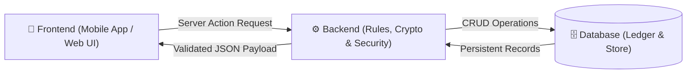

# 🎓 GitClub — Mirai School of Technology Club Operations Platform
> **Unified Co-Curricular Platform for Student Leadership, Attendance, Rubric Evaluations, and Cryptographic Transcripts.**

---

## 📌 Executive Summary

**GitClub** is an enterprise co-curricular operations platform built for **Mirai School of Technology (MSOT)**. It unifies the campus's 3 primary organizations, 8 specialized subordinate units, and flagship initiatives into a single digital ecosystem with non-double-counted analytics, cryptographic fraud prevention, and verifiable credentials.

* **Live Deployment**: [https://temporary-fleet-bronze-3wykoo8.vercel.app](https://temporary-fleet-bronze-3wykoo8.vercel.app)
* **GitHub Repository**: [https://github.com/piyushkumar5498818-create/Clyro](https://github.com/piyushkumar5498818-create/Clyro)

---

## 🏗️ Architecture Breakdown: Frontend, Backend & Database



### 1. Frontend (Client Layer)
* **What it does**: What users see and touch on mobile phones and browsers. Handles input validation, touch gestures, smooth animations, and instant UI state updates.
* **Stack**: Next.js 14 App Router, React 18, Tailwind CSS, Framer Motion, Lenis Smooth Scroll.
* **Key Files**:
  - `src/app/dashboard/page.tsx`: Single-canvas mobile dashboard orchestrator.
  - `src/components/MobileBottomNav.tsx`: Sticky bottom navigation dock with safe-area notch padding.
  - `src/components/ClubsHierarchyView.tsx`: Collapsible accordion club cards with embedded teams.
  - `src/components/Navbar.tsx`: Compact mobile header with section context and persona capsule.

### 2. Backend (Server Logic Layer)
* **What it does**: Runs securely on Vercel Node.js Edge servers. Enforces institutional constraints, validates user roles, signs HMAC tokens, and verifies submissions.
* **Stack**: Next.js Server Actions (`"use server"`), Node.js `crypto`.
* **Key Files**:
  - `src/actions/memberships.ts`: Membership requests, duplicate checks, executive approval desk.
  - `src/actions/attendance.ts`: 60-minute dynamic TOTP generation, check-in validation, audit logs.
  - `src/actions/auth.ts` & `src/lib/auth.ts`: HMAC-SHA256 session token signing and verification.
  - `src/actions/submissions.ts` & `src/actions/evaluations.ts`: Deliverable tracking and 100-pt rubric grading.
  - `src/app/api/auth/google/callback/route.ts`: Google Workspace SSO OAuth callback.

### 3. Database (Persistence Layer)
* **What it does**: Stores data tables for profiles, organizations, units, memberships, attendance records, rubrics, and certificates.
* **Stack**: Supabase PostgreSQL schemas & in-memory transactional store (`src/lib/store.ts`).
* **Key Files**:
  - `src/types/database.ts`: TypeScript data contracts for all entities.
  - `src/lib/store.ts`: Database queries, constraint enforcement, and initial seed state.

---

## 🚀 Core Features & Modules

### 1. Interactive Organizations Hub & Specialized Units
* **Kaizen Tech (Technical Club)**:
  - 3 Technical Domains: **Competitive Programming (`CP`)**, **Fullstack Web (`WEB`)**, and **AI & Data Science (`AI_DS`)**.
  - 4-Phase structured learning roadmaps with assigned domain mentors.
* **NEX-CELL (Entrepreneurship Club)**:
  - 6 Flagship Startup Tracks: *Founders Fire*, *Scrap to Scale*, *Masterminds*, *Founder Talks*, *The Mirage*, *Open Build*.
* **MALHAR (Cultural Society)**:
  - 5 Cultural Departments: **Management (`MGMT`)**, **Media (`MEDIA`)**, **Tech (`TECH`)**, **Designing (`DESIGN`)**, **Public Relations (`PR`)**.
  - Authentic 12-member committee with live Supabase avatars.

### 2. Institutional Membership Policy
* **Two-Tier Membership**: Students enroll under `Primary` or `Secondary` status.
* **Institutional Cap**: Strictly enforces a maximum of **2 primary club memberships** per student to prevent burnout.
* **Review Desk**: Club Presidents and VPs review, approve, or reject pending student applications.

### 3. Anti-Fraud Smart Attendance (TOTP & Dynamic QR)
* **60-Minute Expiration**: Dynamic session passcodes (e.g. `GITCLUB-1477`) and live QR codes generated on the fly.
* **Single Check-In Guarantee**: Blocks duplicate check-in attempts by the same student in the same session.
* **Audited Overrides**: Coordinators can manually adjust attendance status only by logging a mandatory audit reason.

### 4. Activity Lifecycle & Executive Approvals
* **Proposal Submission**: Club leads propose events with date, time, venue, topic, and deliverable deadlines.
* **Two-Tier Governance**: Plans start as `submitted_for_approval` and require formal executive sign-off from the Club President or Vice President before publishing.

### 5. Deliverables & 100-Point Dynamic Rubric Engine
* **Proof-of-Work Submission**: Students submit GitHub repository links, Figma prototypes, pitch decks, or video demos.
* **100-Point Multi-Criteria Evaluation**:
  - **Technical Content & Depth**: Max 40 points
  - **Execution & Presentation**: Max 30 points
  - **Participation & Effort**: Max 30 points
* Mentors record qualitative feedback notes, and total scores automatically calculate.

### 6. Verifiable Credentials & Public Ledger (`/verify`)
* **Cryptographic Code**: Each issued certificate receives a tamper-proof verification code (e.g. `GITCLUB-NEX-7839`).
* **Public Ledger**: Recruiters and faculty can verify authentic credentials on `/verify` without needing an account.
* **Instant A4 PDF**: Client-side PDF export with official borders, signature metadata, and verification ledger stamps.

### 7. Mobile-First Touchscreen UI
* **Sticky Bottom Navigation Dock**: 5 primary thumb tabs (`[01] Overview`, `[02] Clubs`, `[03] Check-In`, `[04] Events`, `[06] Ledger`) with iPhone safe-area padding.
* **Zero Hover Dependencies**: All information, student IDs, and action buttons are directly legible on touchscreens.

---

## 🔐 Role-Based Access Control (RBAC) Matrix

| Capability / Action | `member` | `lead` | `vice_president` | `president` | `admin` |
| :--- | :---: | :---: | :---: | :---: | :---: |
| **Request Club Enrollment (Max 2)** | ✅ | — | — | — | — |
| **Check In to Sessions (QR / TOTP)** | ✅ | ✅ | ✅ | ✅ | ✅ |
| **Submit Proof-of-Work Deliverables** | ✅ | — | — | — | — |
| **Download Official Verified PDF Certs**| ✅ | ✅ | ✅ | ✅ | ✅ |
| **Generate 60-Min Dynamic Attendance QR**| ❌ | ✅ | ✅ | ✅ | ✅ |
| **Draft & Propose Activity Plans** | ❌ | ✅ | ✅ | ✅ | ✅ |
| **Grade Submissions (100-Pt Rubric)** | ❌ | ✅ | ✅ | ✅ | ✅ |
| **Audit & Correct Attendance Records** | ❌ | ✅ | ✅ | ✅ | ✅ |
| **Approve / Reject Activity Plans** | ❌ | ❌ | ✅ | ✅ | ✅ |
| **Approve / Reject Student Memberships**| ❌ | ❌ | ✅ | ✅ | ✅ |
| **Issue Verified Ledger Certificates** | ❌ | ❌ | ✅ | ✅ | ✅ |
| **Campus-Wide Superuser Admin Oversight**| ❌ | ❌ | ❌ | ❌ | ✅ |

---

## 👥 Campus Directory: All 26 Authorized Accounts

### 1. Central Administration (1)
| Name | Title | System Role | Email Address |
| :--- | :--- | :--- | :--- |
| **Campus Administrator** | Dean of Student Affairs / Platform Admin | `admin` | `admin@mirai.edu` |

### 2. Kaizen Tech — Technical Club (6)
| Name | Title / Domain | System Role | Email Address |
| :--- | :--- | :--- | :--- |
| **Rishav Raj** | President — Kaizen Tech | `president` | `rishav.president@mirai.edu` |
| **Aarav Pathak** | Vice President & AI/DS Lead | `vice_president` | `aarav.vp@mirai.edu` |
| **Sagar Kumar** | Programming Head (CP Domain) | `lead` | `sagar.lead@mirai.edu` |
| **Saurav Kumar** | Design & Web Engineering Head | `lead` | `saurav.lead@mirai.edu` |
| **Siya Bhardwaj** | Treasurer — Kaizen Tech | `lead` | `siya.treasurer@mirai.edu` |
| **Alex Rivera** | Student Member (Technical Fellow) | `member` | `alex.student@mirai.edu` |

### 3. NEX-CELL — Entrepreneurship Club (7)
| Name | Title / Track | System Role | Email Address |
| :--- | :--- | :--- | :--- |
| **Arman Mehta** | President — NEX-CELL | `president` | `arman.president@mirai.edu` |
| **Rohan Varma** | Vice President — NEX-CELL | `vice_president` | `rohan.vp@mirai.edu` |
| **Tanya Kapoor** | Incubation & Venture Lead | `lead` | `tanya.incubation@mirai.edu` |
| **Kabir Joshi** | Pitch & Demo Day Lead | `lead` | `kabir.pitch@mirai.edu` |
| **Devansh Soni** | Hackathon & Mirage Lead | `lead` | `devansh.hack@mirai.edu` |
| **Meera Nair** | Student Founder (Scrap to Scale) | `member` | `meera.founder@mirai.edu` |
| **Ishaan Verma** | Student Founder (Open Build Track) | `member` | `ishaan.founder@mirai.edu` |

### 4. MALHAR — Cultural Society (12)
| Name | Title / Department | System Role | Email Address |
| :--- | :--- | :--- | :--- |
| **Sapna Singh** | President — Cultural Society | `president` | `sapna.president@mirai.edu` |
| **Kiran Sinha** | Vice President — Cultural Society | `vice_president` | `kiran.vp@mirai.edu` |
| **Anshika** | Treasurer — Cultural Society | `lead` | `anshika.treasurer@mirai.edu` |
| **Dhruv Tomar** | Media Head (Cinematography & Content) | `lead` | `dhruv.media@mirai.edu` |
| **Shivam Kumar** | Tech Head (Audio-Visual & Systems) | `lead` | `shivam.tech@mirai.edu` |
| **Priyanka Negi** | Designing Head (Stage Aesthetics) | `lead` | `priyanka.design@mirai.edu` |
| **Purnima Raj** | Management Head (Event Production) | `lead` | `purnima.mgmt@mirai.edu` |
| **Anchal Kumari** | Management Member | `member` | `anchal.mgmt@mirai.edu` |
| **Aanya Varshney** | Design Member | `member` | `aanya.design@mirai.edu` |
| **Shambhavi Sharma**| Management Member | `member` | `shambhavi.mgmt@mirai.edu` |
| **Anup Gupta** | Management Member | `member` | `anup.mgmt@mirai.edu` |
| **Sanskar Singh** | Management Member | `member` | `sanskar.mgmt@mirai.edu` |

---

## 🛠️ Local Development & Testing

### 1. Clone & Install
```bash
git clone https://github.com/piyushkumar5498818-create/Clyro.git
cd Clyro
npm install
```

### 2. Run Local Development Server
```bash
npm run dev
```
Open [http://localhost:3000](http://localhost:3000) in your browser (or use mobile inspection mode in Chrome/Safari dev tools).

### 3. Run Automated Workflow & Integrity Test Suite
```bash
npm test
```
Executes all **50/50 automated institutional integrity tests** verifying membership caps, cryptographic tokens, Google Workspace domain restrictions, and rubric calculations.
